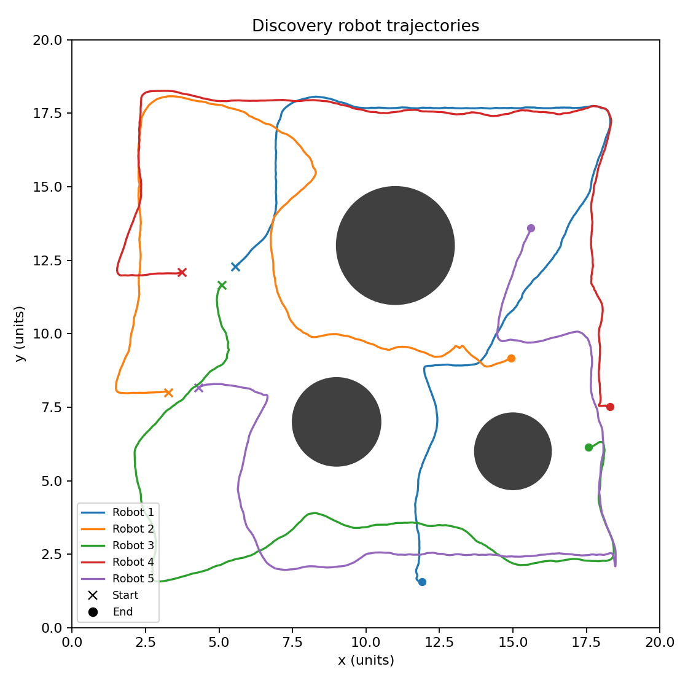
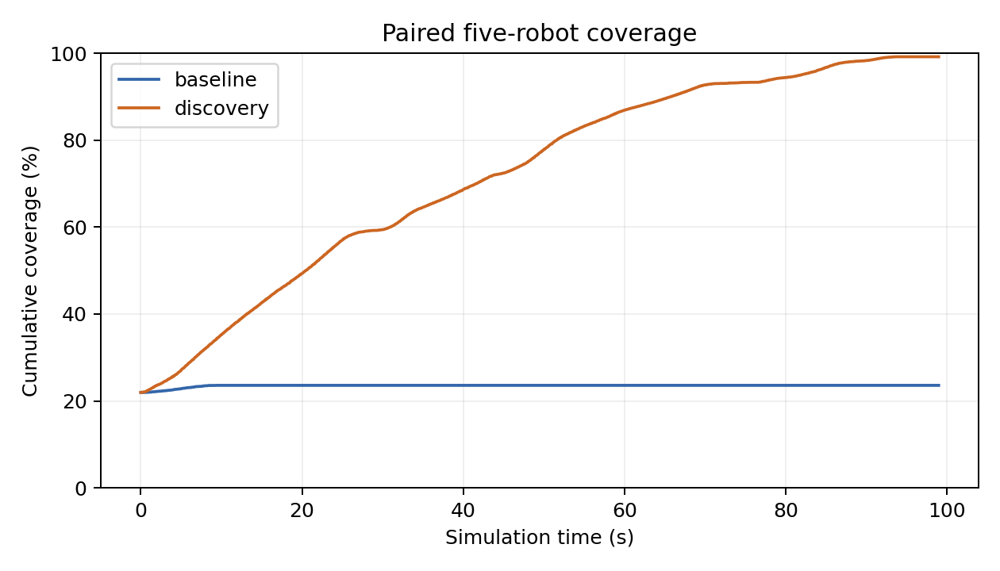

# MAE 598: Multi-Robot Exploration

## Project Overview

This project compares repulsion-only deployment with local discovery-driven exploration in a two-dimensional multi-robot simulation. Robots use damped second-order dynamics, finite-range potential-field forces and idealized local sensing. The comparison measures cumulative free-space coverage, travel distance, threshold times and collision clearances under matched initial conditions.

The controllers are inspired by the literature listed below; they adapt selected ideas rather than reproduce a complete published algorithm.



*Five robots explore around circular obstacles using local discovery attraction. Colored paths show the historical run that reached 99.3158% coverage in 60 seconds.*

## Key Features

- Baseline robot-to-robot and robot-to-obstacle repulsion.
- Discovery attraction toward the nearest locally known-free, privately unexplored cell.
- Private maps without communication or global coverage feedback.
- Seeded initialization, capped motion and swept-disk collision enforcement.
- Paired experiments across robot counts, obstacle layouts and initialization seeds.
- Continuous fixed-field energy analysis and a certified local equilibrium example.

## Mathematical Model

For robot positions $x_i$ and velocities $v_i$, the nominal dynamics are

$$
\dot x_i=v_i,\qquad m\dot v_i=F_i-bv_i.
$$

Each repulsive component sums

$$
k\frac{x_i-p}{\lVert x_i-p\rVert^3+\epsilon}
$$

over neighboring robots or sampled obstacle/wall points $p$ within its interaction radius. Robot self-interaction is excluded. Circle perimeters and workspace walls are sampled at intervals of at most 0.5 unit.

The simulator uses velocity-first semi-implicit Euler: it caps acceleration, updates and caps velocity, then advances position. Swept-disk checks shorten all simultaneous displacements by a common factor before contact and reset all velocities when a safety intervention occurs. These global simulation safeguards are separate from the local control law.

Coverage is the percentage of free grid-cell centers sensed by at least one robot, accumulated over time. Occupancy and exploration sensing are ideal disks without occlusion.

## Baseline and Discovery Controllers

The baseline uses $F_i=F_{\mathrm{rr},i}+F_{\mathrm{obs},i}$. Discovery adds

```math
F_{\mathrm{disc},i} = k_d \frac{q_i^{*} - x_i}{\max\left(\lVert q_i^{*} - x_i\rVert,\epsilon\right)}
```

The selected cell $q_i^{*}$ is the nearest eligible center within the discovery radius: known free in that robot's private map and not yet privately explored. Ties use grid row/column order. Targets are selected again at each step; an empty candidate set gives zero attraction. This is the singleton, distance-normalized choice of the project's weighted discovery-force family, with constant scaling. Setting discovery gain to zero reproduces baseline motion.

Each robot knows its pose, workspace bounds and grid coordinates. Occupancy is classified within 5 units, while exploration counts only within 2.5 units. This longer occupancy lookahead is an explicit added sensing assumption. Maps persist locally and are never exchanged; robots may revisit areas already explored by teammates.

| Setting | Current `Config()` default |
| --- | --- |
| Workspace / grid | 20 × 20 / 0.25 unit |
| Robots / body radius | 5 / 0.2 unit |
| Exploration / occupancy radius | 2.5 / 5 units |
| Robot / obstacle interaction radius | 4 / 2 units |
| Robot / obstacle gain | 2 / 0.50 |
| Mass / damping | 1 / 1.5 |
| Speed / acceleration cap | 1.5 / 3 |
| Epsilon | 0.000001 |
| Duration / timestep | 60 s / 0.05 s |
| Seed | 600 |
| Circular obstacles `(x,y,r)` | (9,7,1.5), (11,13,1.5), (15,5,1.5) |
| Discovery gain | 1.2 |

`main.py` independently defaults to seed 598. The commands below explicitly use 600 to match `Config()`. The experiment matrix uses seed 598 for count/layout cases and five specified seeds for initialization trials. The theoretical equilibrium example explicitly uses obstacle gain 0.35.

## Installation and Requirements

The original simulator supports Python 3.9. Use Python 3.11 for the optional Robotarium validation as well. Run these commands from the repository root:

```sh
python3.11 -m venv .venv
source .venv/bin/activate
python -m pip install -r requirements.txt
```

Pinned runtime dependencies are NumPy 2.0.2, SciPy 1.13.1, Matplotlib 3.9.4, Pandas 2.3.3 and Pillow 11.3.0. SciPy is used for the separate theoretical analysis. To use pytest, install it separately with `python -m pip install pytest`; it is not listed in the runtime requirements. The standard-library unittest runner is also supported.

Pillow exports GIFs without FFmpeg. FFmpeg is needed only to regenerate MP4 videos. If cache access is restricted, prefix Python commands with `MPLCONFIGDIR=/tmp/mae_matplotlib XDG_CACHE_HOME=/tmp/mae_cache`.

## Running Simulations

```sh
python Code/main.py --controller baseline --seed 600 --output Results/baseline_repeat
python Code/main.py --controller discovery --seed 600 --output Results/discovery_repeat
python Code/main.py --controller discovery --seed 600 --duration 5 --output Results/discovery_check --no-animation
```

Choose a new or empty subfolder of `Results/` for each run. Existing nonempty destinations are protected. Omitting `--output` selects `Results/baseline` or `Results/discovery`, which contain historical results. Available options include `--duration`, `--dt`, `--seed`, `--robots`, `--discovery-gain`, `--discovery-radius` and `--no-animation`. Other parameters are in `Code/config.py`.

Each run exports environment, trajectory, coverage-map and coverage-time PNGs; coverage and robot-state CSVs; parameters and summary JSONs; and a compressed final coverage grid. Animation is `baseline.gif` or `discovery.gif` unless disabled. Discovery additionally exports target histories, private maps, safety events and independent validation checks.

## Experiments and Comparisons

```sh
python Code/experiments.py --short --output Results/experiments_check
python Code/experiments.py --output Results/experiments_repeat
python Code/comparison.py Results/experiments_repeat
```

The smoke pair lasts 5 seconds. The complete suite uses 60 seconds and compares counts 3/5/8, layouts original/open/cluttered, and seeds 598/42/123/2026/7. It records 11 pairs using 18 unique simulations; repeated configurations refer to canonical runs. The cluttered layout adds five circles to the original layout. Both modes receive identical physical parameters and initial states within each pair.

Fresh suites use the current configuration's obstacle gain 0.50 and original obstacle layout. The saved historical suite uses gain 0.35 and original circles (9,7,1.5), (11,13,2), (15,6,1.3), with seed 598 except in the other seed trials. Its [configuration](Results/experiments/experiment_config.json) and per-run parameter records preserve those settings. Fresh-suite commands do not reproduce the historical statistics by default.

The runner writes `all_results.csv`, `summary_statistics.csv`, per-run metrics and an experiment manifest, and generates seven figures in `comparisons/`. The comparison command regenerates those figures and can overwrite them; use the new suite folder shown above. Threshold times are first recorded samples at or above 50%, 75% and 90%, without interpolation. Unreached thresholds remain blank with explicit status; NR markers are not measured times. Coverage gains are percentage points, and travel is total team path length in abstract units.

## Theoretical Analysis

For the continuous conservative baseline, a compatible radial potential is

$$
\phi(r)=k\int_r^R\frac{s}{s^3+\epsilon}\,ds\quad(r<R),\qquad\phi(r)=0\quad(r\ge R).
$$

Counting robot pairs once, let $U$ be the summed potential and $E=U+\frac{m}{2}\sum_i\lVert v_i\rVert^2$. On a smooth region with a fixed active interaction set,

$$
\dot E=-b\sum_i\lVert v_i\rVert^2.
$$

Energy dissipation and conditional convergence to the equilibrium set require the conservative continuous model, fixed active sets and the stated regularity and compact invariant-set assumptions. Hard interaction cutoffs, target switching, changing maps, clipping and safety resets prevent automatic transfer to the full simulator.

A separate one-robot 3 × 3 square-wall example uses obstacle gain 0.35 and equilibrium (1.5,1.5). Its positive-definite Hessian and invariant sublevel bounds establish local asymptotic stability within a certified neighborhood. This is a specific local result, not a global convergence, complete-coverage or stability guarantee for the full discovery controller.

```sh
python Code/theoretical_analysis.py --output Results/theoretical_validation_repeat
```

This validation uses DOP853 integration without clipping or safety resets. It exports `fixed_field_history.csv`, parameters, an equilibrium certificate, a summary and four plots. The saved perturbation error decreases from approximately 0.00361 to 1.82e-9 units over 20 seconds within the certified 0.01-unit neighborhood. Numerical plots support the analysis; they are not mathematical proofs. The exported certificate contains a local research-note provenance path that is not part of the public repository.

## Results and Visualizations

All numerical findings here refer to the saved historical configurations, not current defaults.

| Historical result | Baseline | Discovery |
| --- | --- | --- |
| Five-robot, seed-598 final coverage at 60 s | 24.1322% | 99.3158% |
| Five-seed mean final coverage ± sample SD | 23.52% ± 0.48 | 93.95% ± 6.55 |
| Five-seed mean total travel | 11.50 | 174.29 |

The original discovery run traveled 173.7809 units. All nine unique historical paired cases favored discovery final coverage, with no recorded collisions or safety interventions. Discovery still reached only 78.07% with three robots, 84.73% in clutter and 82.71% for seed 7. The count/layout comparisons use one seed and do not establish general scaling or superiority on arbitrary maps.

- Coverage: [baseline](Results/baseline/coverage_vs_time.png), [discovery](Results/discovery/coverage_vs_time.png).
- Trajectories: [baseline](Results/baseline/trajectories.png), [discovery](Results/discovery/trajectories.png).
- Environment: [baseline](Results/baseline/environment.png), [discovery](Results/discovery/environment.png).
- Coverage maps: [baseline](Results/baseline/coverage_map.png), [discovery](Results/discovery/coverage_map.png).
- Comparisons: [coverage over time](Results/experiments/comparisons/01_coverage_vs_time.png), [robot counts](Results/experiments/comparisons/02_robot_counts.png), [environments](Results/experiments/comparisons/03_environments.png), [seeds](Results/experiments/comparisons/04_random_seeds.png), [mean coverage](Results/experiments/comparisons/05_mean_coverage.png), [threshold times](Results/experiments/comparisons/06_threshold_times.png), [travel](Results/experiments/comparisons/07_travel_distance.png).
- Data: [paired results](Results/experiments/all_results.csv), [summary statistics](Results/experiments/summary_statistics.csv).
- Theory: [energy](Results/theoretical_validation/energy_vs_time.png), [speed](Results/theoretical_validation/speed_vs_time.png), [equilibrium error](Results/theoretical_validation/distance_to_equilibrium.png), [perturbation recovery](Results/theoretical_validation/perturbation_recovery.png), [certificate](Results/theoretical_validation/equilibrium_certificate.json).
- Videos: [baseline](Videos/baseline.mp4), [discovery](Videos/discovery.mp4).

Both videos were regenerated using the latest simulation and visualization code with the saved historical configuration: seed 598, obstacle gain 0.35, and the original obstacle layout (9,7,1.5), (11,13,2), (15,6,1.3). They use identical initial conditions and environment settings for a fair comparison. Final coverage is 24.1322% for baseline and 99.3158% for discovery. Initial coverage is approximately 13.57% because the robots sense their surroundings at time zero. The baseline stops exploring when its finite-range repulsive forces vanish and damping removes its remaining motion, whereas discovery continues exploring.

Both H.264 MP4 videos use yuv420p, 960×960 resolution, 20 fps and 1,201 frames, with a duration of 60.05 seconds for the complete 60-second simulation. Playback is approximately real time; the extra frame includes both simulation endpoints. Thin, semi-transparent robot trajectory trails preserve each robot's color, with solid robot markers drawn above them. Obstacles, explored regions, coverage percentages and simulation timestamps remain visible. The videos have no audio and can be regenerated with `Code/render_videos.py` and FFmpeg.

Install the pinned Python dependencies from `requirements.txt` and FFmpeg with `ffprobe` and the `libx264` encoder available on `PATH`. From the repository root, render a separate copy without changing the published videos:

```sh
python Code/render_videos.py --output /tmp/mae598_video_check
```

The script loads the saved historical parameters and initial states, verifies both complete simulations against the saved CSVs, checks paired inputs, and validates the encoded MP4s. It uses 960×960, 20 fps, 1,201 frames, linewidth 1.1 and trail alpha 0.55. To deliberately replace the videos in `Videos/`, run `python Code/render_videos.py --overwrite`. Existing destinations require explicit overwrite permission; output under `Results/` is refused. Encoded bytes may vary with FFmpeg, fonts and platform, while simulation histories and video specifications are checked.

## Robotarium Simulator Validation

An additional validation runs both exploration controllers through the [official Robotarium Python simulator](https://github.com/robotarium/robotarium_python_simulator), version 2.1.0 at commit `2b1b6136a242c164e53081b794ebf10d904cbaae`. These are local unicycle simulations, not experiments on physical Robotarium robots. The original simulator and historical results remain unchanged.

Robotarium provides an independent motion engine, an official velocity mapping and barrier certificates. This work supplies code, paired experiments, plots and videos for Section IV of the MAE 598 report. The guidelines allow up to six additional points for an approved simulator. The Canvas list includes “5a. 2D Robotarium simulator in MATLAB and Python,” as confirmed by the student. The points awarded remain the professor's decision; no hardware-validation claim is made.

### Installation and reproduction

Activate the existing Python 3.11 environment, then install the optional dependencies. CVXOPT has a compatible Apple Silicon wheel, so SuiteSparse compilation is unnecessary on the tested setup. Git is needed to install the pinned upstream revision; FFmpeg with `libx264` is needed for videos.

```sh
source .venv/bin/activate
python -m pip install --only-binary=cvxopt -r requirements-robotarium.txt
python Code/robotarium_validation.py --short --output /tmp/mae598_robotarium_smoke_new
python Code/robotarium_validation.py --output Results/robotarium_repeat/experiments
python Code/robotarium_analysis.py --root Results/robotarium_repeat --trials --figures --videos Videos/robotarium_repeat
python Code/robotarium_validation.py --verify Results/robotarium_repeat/experiments/open_n5_seed598 --verification-output /tmp/mae598_robotarium_replay_new.json
```

Use new or empty destinations; existing run folders and videos are protected. These commands leave the committed evidence untouched. The tested Anaconda-based environment has a crashing `readline` extension when pip or pytest imports it. If affected, the process-local installation workaround below disables only that optional interactive module. No Python installation or system library was replaced.

```sh
python - <<'PYTHON'
import runpy, sys
sys.modules['readline'] = None
sys.argv = ['pip', 'install', '--only-binary=cvxopt', '-r', 'requirements-robotarium.txt']
runpy.run_module('pip', run_name='__main__')
PYTHON
```

### Controller adaptation and safety

The 20 × 20 project workspace maps uniformly to a 1.8 × 1.8 m square inside the official arena, at 0.09 m per project unit. Obstacle geometry, grid spacing, sensing and interaction ranges use the same scale. The original body radius would become only 0.018 m, which is too small for Robotarium. The platform configuration therefore uses a conservative 0.095 m body radius and a seeded, more widely spaced initialization. This explicit adjustment prevents a claim of exact dynamic similarity with the historical runs.

The original forces update a damped planar velocity reference. The official mapping converts a safe projected-point velocity to unicycle inputs through a point 0.03 m ahead of each robot. Planar references are capped at 0.08 m/s, wheel commands respect the native 0.2 m/s limit, and the official barrier QP handles robot separation and square boundaries. The original swept-disk geometry further scales actual wheel commands before body, wall or circle contact. Circle safety is checked separately; the inter-robot barrier alone does not handle the circular obstacles. A one-micrometre guard margin addresses numerical contact rounding, not hardware uncertainty. The common guard can pause the whole team, and small QP residuals can cause slight baseline drift. Logged barrier corrections count changes to nominal velocity; they are not collision or near-collision counts.

Coverage and private maps use actual axle positions, ideal pose information and unoccluded sensing. Private exploration decisions remain local, while the barrier QP and common swept-motion guard are centralized safety layers. This is a kinematic adaptation, not an implementation of the original second-order dynamics on physical robots. The original convergence and stability proofs do not transfer automatically.

### Executed comparisons

The main suite uses 99 seconds at the native 0.033 s timestep (3,000 steps), matched initial poses and identical settings within every controller pair. It covers counts 3/5/8, five seeds for the five-robot open layout, and a paired circular-obstacle layout. Separate near-boundary/near-neighbor trials and a one-robot fixed-field trial examine safety and the connection to the theoretical model.

For the five-robot open layout, seed 598:

| Robotarium metric | Baseline | Discovery |
| --- | --- | --- |
| Initial coverage | 21.9531% | 21.9531% |
| Final coverage at 99 s | 23.5781% | 99.2031% |
| Total team travel | 0.1858 m | 19.4663 m |
| Minimum swept center separation | 0.2793 m | 0.2759 m |

Across five initialization seeds for the five-robot open layout, final coverage was 23.8969 ± 0.2861% for baseline and 98.9500 ± 0.5167% for discovery (mean ± sample standard deviation). In the circle-obstacle pair, coverage was 25.1335% and 98.0140%. Discovery improved coverage in all eight measured pairs; this is not a universal performance guarantee. Independent checks found no collisions or boundary violations in the 16 main runs. The circle guard reduced commands on 579 discovery steps.

The [results table](Results/robotarium/experiments/all_results.csv) summarizes the evaluated cases. Detailed five-seed statistics are preserved in the local results backup. These values describe the platform configuration, not the historical 24.1322% / 99.3158% comparison above. The detailed verification record, including safety measurements, replay checks, and artifact specifications, is preserved in the local results backup. Wider starts can invoke the existing placement fallback: in the five-robot seed-598 case, two robots start outside the original small cluster and one initially has zero repulsive force. Baseline mainly makes a short deployment adjustment; discovery has an ongoing exploration objective. This is a matched comparison of those behaviors, not evidence of travel efficiency or superiority over other exploration algorithms.



*Coverage measured from actual Robotarium poses in the paired five-robot open case.*

Figures are in [Results/robotarium/figures](Results/robotarium/figures/). The [baseline video](Videos/robotarium/baseline.mp4) and [discovery video](Videos/robotarium/discovery.mp4) replay saved inputs through the native engine and check every pose against the records. Both are H.264 MP4, 960×640, 10 fps, 301 frames and 30.10 seconds, showing the complete 99-second simulation at approximately 3.3× playback. They use native robot patches, thin trails, coverage and simulation timestamps. These additional videos do not replace the original 960×960 videos.

A separate fixed-field projected-point trial reduces the equilibrium error from 0.00361 to about 9.61e-10 project units over 19.8 seconds. Its reference energy decreases to floating-point precision. This is numerical support for a restricted connection to the continuous model, not a stability proof for the unicycle or discovery controller.

The Robotarium work was implemented and documented with assistance from OpenAI Codex. Executed tests, saved numerical records and independent geometric checks were used to check the generated code and statements. The course report should retain this disclosure and identify the student's own analysis and verification.

## Testing and Reproducibility

```sh
python -m pytest Code/ -q
python -m unittest discover -s Code -p 'test_*.py' -v
```

For the Anaconda `readline` issue described above, run the same tests through this process-local workaround:

```sh
PYTHONDONTWRITEBYTECODE=1 MPLCONFIGDIR=/tmp/mae598_robotarium_mpl python - <<'PYTHON'
import sys, pytest
sys.modules['readline'] = None
raise SystemExit(pytest.main(['Code/', '-q', '-p', 'no:cacheprovider']))
PYTHON
```

The original 48 tests passed before integration. Verification with Robotarium installed passed all 62 tests with 14 third-party Matplotlib/Pyparsing deprecation warnings. The 14 optional Robotarium tests skip when its dependencies are absent. The original simulator was also run with Robotarium and CVXOPT imports deliberately blocked.

The original suite has 48 tests covering forces, private sensing, target selection, dynamics, collision validation, experiment fairness, historical regression, potential derivatives and the local theoretical example. Historical regression restores saved configurations and checks complete trajectories, velocities and coverage; it does not require controller source bytes to remain identical after comment or configuration-name updates.

Required saved fixtures are `Results/experiments/preservation.json` and `parameters.json`, `coverage.csv`, and `robot_positions.csv` under each of `Results/baseline/` and `Results/discovery/`. The preservation manifest includes older local file inventory entries, but the test checks only these six saved baseline/discovery files. The test loads this repository-relative manifest directly.

With the selected canonical numerical artifacts retained, historical replay is available:

```sh
python Code/experiments.py --verify --output Results/experiments --verification-output Results/replay_check_repeat.json
```

Replay restores saved parameters, including older configuration-name aliases, and compares states, coverage, grids, discovery targets, private maps, safety events and summary metrics. The separate verification destination preserves the supplied records. Experiment tables, metrics and duplicate-run references use repository-relative output paths. The resolver also supports older absolute paths by locating matching canonical folders under the current experiment hierarchy. Keep that hierarchy intact when copying the repository.

## Repository Structure

The published repository contains:

```text
MAE598-Multi-Robot-Exploration/
├── .gitignore
├── README.md
├── requirements.txt
├── requirements-robotarium.txt
├── Code/
│   ├── config.py
│   ├── environment.py
│   ├── controllers.py
│   ├── robots.py
│   ├── simulation.py
│   ├── main.py
│   ├── render_videos.py
│   ├── robotarium_validation.py
│   ├── robotarium_analysis.py
│   ├── test_robotarium.py
│   ├── visualization.py
│   ├── validation.py
│   ├── experiments.py
│   ├── comparison.py
│   ├── theoretical_analysis.py
│   ├── test_baseline.py
│   ├── test_discovery.py
│   ├── test_experiments.py
│   └── test_theory.py
├── Results/
│   ├── baseline/
│   ├── discovery/
│   ├── experiments/
│   ├── theoretical_validation/
│   └── robotarium/
└── Videos/
    ├── baseline.mp4
    ├── discovery.mp4
    └── robotarium/
```

Selected results retain presentation figures, configurations, summaries and the numerical artifacts needed by tests and historical replay. Repeated experiment plots, GIF copies and local working materials are excluded from the public repository.

## Limitations

Local nearest-target selection can oscillate, stagnate or revisit teammates' explored regions. The occupancy lookahead exceeds the exploration radius and must be justified for any hardware interpretation. Ideal sensing ignores occlusion; robots assume known bounds and poses. Sample density affects aggregate obstacle repulsion.

The global synchronous collision safeguard may stop unrelated robots or deadlock, and instantaneous safety stops are exceptions to the acceleration cap. The complete simulator therefore combines local decisions with centralized geometric safety enforcement. Theoretical guarantees cover the restricted continuous baseline and a specific local equilibrium, not the full discovery controller. A small seed sample and idealized maps do not provide a hardware performance guarantee.

## References

1. A. Howard, M. J. Matarić and G. S. Sukhatme, “Mobile Sensor Network Deployment using Potential Fields: A Distributed, Scalable Solution to the Area Coverage Problem,” *Distributed Autonomous Robotic Systems 5*, 2002, pp. 299–308.
2. T.-M. Liu and D. M. Lyons, “Leveraging area bounds information for autonomous decentralized multi-robot exploration,” *Robotics and Autonomous Systems*, vol. 74, 2015, pp. 66–78.
3. M. Schwager, D. Rus and J.-J. Slotine, “Unifying geometric, probabilistic, and potential field approaches to multi-robot deployment,” *The International Journal of Robotics Research*, vol. 30, no. 3, 2011, pp. 371–383. DOI: 10.1177/0278364910383444.
4. S. Wilson et al., “The Robotarium: Globally Impactful Opportunities, Challenges, and Lessons Learned in Remote-Access, Distributed Control of Multirobot Systems,” *IEEE Control Systems Magazine*, vol. 40, no. 1, 2020, pp. 26–44. [DOI: 10.1109/MCS.2019.2949973](https://doi.org/10.1109/MCS.2019.2949973). The [official website](https://www.robotarium.gatech.edu/) provides citation guidance; the pinned [Python source](https://github.com/robotarium/robotarium_python_simulator/tree/2b1b6136a242c164e53081b794ebf10d904cbaae) supplies the engine, mapping and barrier utilities.

These sources motivate deployment, decentralized discovery and potential-field analysis. The normalized nearest-cell controller and the concrete equilibrium estimates are project-specific choices and derivations.
